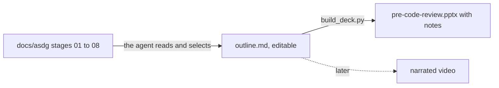

# ASDG Pre-code review: deck from stages 01 to 08

The human reviews the project and the sprint before coding starts. This skill assembles what the specialists already documented; it writes no new project content.

*The agent chooses and words the slides; the script only renders them.*

## Workflow

1. Run `python3 asdg/scripts/cli.py status --json` for the project and sprint. Preserve this chat's role, subject and attitude.
2. Read each stage folder from 01 to 08 under `docs/asdg/`, starting at its README. In Planning, read the current sprint's documents, not ASDG change records.
3. Write the outline at `docs/asdg/00-governance/presentation/outline.md` in the [outline format](build_deck.md#outline-format), or at another path the human names. Ask before replacing an outline someone edited.
4. Run `python3 asdg/skills/asdg-pre-code-review/build_deck.py --check` and fix every problem it prints.
5. Run the script without `--check`. If it says `python-pptx` is missing, run it once with `--setup`, then again.
6. Report the slide list the script prints, every GAP, every visual it could not convert, and the path of the `.pptx`.

## Rules for the outline

- Assemble, never invent: each point and note comes from a stage document named in the slide's `Source:` line.
- One to three slides per subject, in lifecycle order: Context, Purpose, Use cases, Evaluation, Architecture, Proof of concept, Sprint plan, Detailed design.
- Where a stage has nothing usable, write a `GAP:` slide that says what was looked for and who owns filling it.
- Reuse existing `.svg` and `.png` files from the stage `images/` folders. Mermaid blocks inside documents cannot be placed.
- Every slide carries speaker notes written to be read aloud: what the slide means and what to check or decide before coding.
- Name contradictions between stage documents in the report; do not resolve them in the deck.

## What it writes

- The outline, a Governance document under [documentation authority](../../00-governance/docs/documentation-authority.md). Another role saves it in its own stage folder with `--outline`.
- `build/pre-code-review.pptx` beside the outline, with a `.gitignore` that keeps the build folder out of Git.
- Converted images and a private Python environment under `.asdg/cache/asdg-pre-code-review/`, which Git already ignores.

## Limits

- It changes no stage document, approval or sprint state, and it does not say the sprint is ready; [Sprint align](../asdg-sprint-align/SKILL.md) does that.
- The script checks structure and that named files exist. It cannot check that a slide is faithful to its source; the human review does.
- SVG conversion needs `rsvg-convert` or Google Chrome. Without either, the slide names the visual it could not place.
- Under ASDG Admin this skill is not run for project work unless the human directs it.
