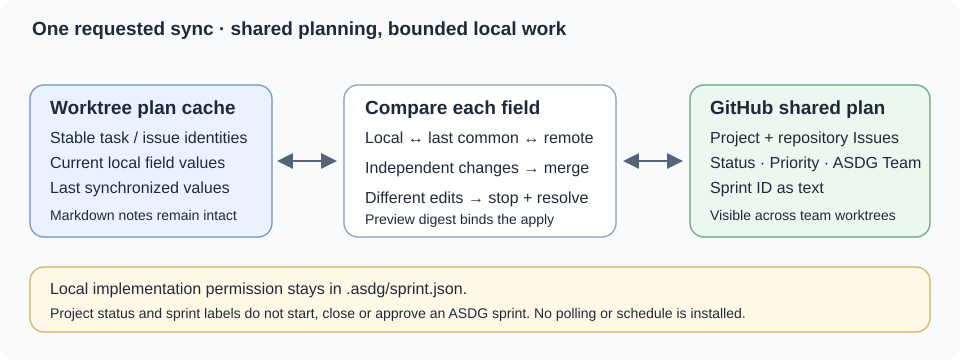

# Project Plan Sync

Use this on-demand utility after an explicit sync request; discovery or ordinary planning alone does not invoke it. The request authorizes this bounded sync, including its required GitHub Project, fields and Issues. Preserve the selected role and all implementation gates.
Read client instructions, [session policy](../asdg-focus/session-policy.md), and the [workflow and cache guide](../../docs/project-plan-sync.md).

## Establish the plan and target

1. From the verified client root run `python3 asdg/scripts/cli.py status --json`; inspect existing `docs/asdg/07-planning/` documents and `project-plan-cache.json` there. Preserve Markdown notes and evidence.
2. Use the recorded repository and Project when present. Otherwise infer the repository from its verified Git remote and use an explicit `--repo owner/repo` or `--project-number N` when needed. Inventory existing repository Issues with a read-only dry run before preparing new items; its `cache_preview` supplies observed remote identities and fields. Use verified issue references or identity markers to establish matches, never a matching title alone. Resolve ambiguous targets or task identities before remote writes.
3. If the cache is absent, `--bootstrap-ref dev` may read an existing structured cache from that Git ref without switching branches. It does not interpret Markdown or give that branch priority during synchronization.
4. If no structured cache is available, inspect relevant planning documents in the requested Git ref read-only as well as this worktree. Prepare items using the guide's schema, preserving documents, historical task labels and source references; omit the bootstrap option once a local cache exists. Use stable task IDs for new Issues. For a verified existing Issue, seed its observed imported entry from `cache_preview`, then record intended field edits; an unmarked Issue uses `github:<number>`, with the old document label retained in notes/source references. Never invent an Issue number or synchronized base. Ask only about material ambiguities in scope, identity or status.
5. Reuse existing `GH_TOKEN`, `GITHUB_TOKEN`, or `gh auth` credentials. Do not print secrets or create credentials. Missing authentication or Project/Issue permissions is a reported prerequisite.
Before preparing the structured cache, run the local `check-write` with this chat's actual `role_id`, `workflow: project-plan-sync`, and the exact target `docs/asdg/07-planning/project-plan-cache.json`. This utility exception does not grant other roles Planning's substantive document ownership.

## Preview, apply and verify

Run `python3 asdg/scripts/cli.py project-plan-sync --dry-run --json`, carrying the same optional target and bootstrap arguments into apply. Inspect its target, creates, field changes, imports, conflicts and plan digest.
A conflict stops the sync. Show the item's last common, local and remote values; obtain the intended resolution when evidence does not establish it. Neither the current branch nor `dev` wins automatically. Never delete an item to bypass a conflict.
When the preview is conflict-free and matches the user's request, run `python3 asdg/scripts/cli.py project-plan-sync --apply --plan <digest> --json` with the same options. The existing explicit sync request is sufficient; do not ask for repetitive approval of its ordinary required writes.
If inputs changed, refresh the preview. For interrupted apply, use `python3 asdg/scripts/cli.py project-plan-sync --resume --json` without plan/bootstrap/Project selection arguments and follow the reported recovery result. Resume stays within the original operation; ambiguous Issue or Project creation requires readback and never a blind retry.
When a changed cache or conflict requires a fresh plan, `--abandon --plan <original-digest> --json` archives the unfinished attempt while retaining local edits and remote results. It refuses an unresolved uncertain write. Explain partial results, resolve the intended item values, then generate a fresh preview; do not manually alter the journal.
Only an explicit human decision about an unresolved outcome permits adding `--acknowledge-uncertain` to abandonment. Never add it autonomously: explain that GitHub may already contain the attempted creation and a fresh create could duplicate it. The flag archives evidence; it neither verifies the outcome nor repeats remote writes.
Report the GitHub Project link, created/updated/imported items, conflicts or partial results, and preserved local notes. A fresh no-change preview is the portable convergence check; native client discovery remains separate.

## Boundaries

Synchronize only the supported title, body, issue state, status, priority, team and sprint fields plus identity metadata. Existing documents and local-only source references remain local.
The `ASDG Sprint` field is a text identifier in this version, not a GitHub iteration calendar or authority to start/close a sprint. A GitHub status change does not widen `.asdg/sprint.json` or establish acceptance.
This utility installs no schedule, polling loop or hook. It performs no branch switch, commit, Git push, deletion, sprint transition, deployment or approval.
