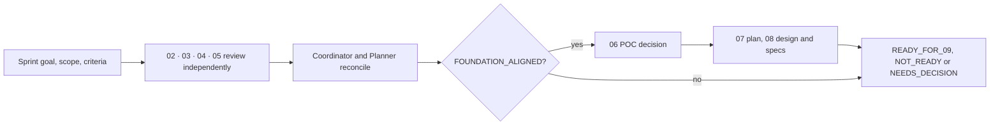

# Align a sprint before implementation

Make sure a sprint is coherent from purpose down to specifications before new code is attempted. The team's existing roles do the work; this skill coordinates them and reports readiness.
Read client instructions, [session policy](../asdg-focus/session-policy.md) and [the sprint gate](../../00-governance/docs/sprint-gate.md). Resolve the client root as `../../..` from this directory.
`$asdg-sprint-align <defined sprint or bounded change>` is a skill invocation, not a terminal subcommand.

## The rule

Whenever a sprint goal, scope or acceptance criterion is defined or materially changed, stages 02, 03, 04 and 05 assess the same baseline independently and reconcile its material requirements before new code is attempted.
Stage 09 product implementation additionally requires an explicit stage 06 POC decision, any necessary experimental findings, a coherent stage 07 plan and sufficiently precise, reviewed stage 08 specifications.
Sprint activation, technical readiness, human acceptance and permission to execute are separate facts; existing approvals and execution checks still apply.

## Where it runs

This is a team-level skill. The project's coordinating parent chat, under 00 Governance, owns and executes the run.
Requested inside a specialist chat, the specialist forwards the request to that coordinator and keeps its own role; follow [routing](routing.md). A stage-specific review assignment never invokes this skill again.
Join a matching run already in progress instead of starting a second one.

## Workflow

1. Bind the sprint: run `python3 asdg/scripts/cli.py status --json` and `sprint status --json`, record the sprint definition, its SHA-256, the Git revision and current explicit stakeholder direction. A proposed sprint is assessed from its stated definition.
2. Planning prepares one review brief; 02, 03, 04 and 05 each return a first-pass report on it. See [reviews](reviews.md).
3. Reconcile the six cross-stage relationships and every material commitment; correct in the owning artifact and recheck. See [reviews](reviews.md#reconcile-the-cascade).
4. Decide the stage 06 POC question, then complete the stage 07 plan and stage 08 design and specifications. See [readiness](readiness.md).
5. Planning saves one alignment and readiness report under [the report contract](report.md).
6. Return `READY_FOR_09`, `NOT_READY` with the exact remaining work, or `NEEDS_DECISION` with one bounded human choice, and stop.

## Limits

An active sprint stays active while preparation is incomplete. Never start, stop, restart or edit a sprint, its branch, scope, approvals or any role selection; a needed scope change is an explicit human decision through [Sprint start](../asdg-sprint-start/SKILL.md) or close.
The skill never starts coding, applies an OpenSpec change, installs anything, edits policies, commits or pushes. Readiness authorizes none of these.
A requested review is not a performed review. Report the real execution mode and returns; a missing, failed or unavailable reviewer makes the run incomplete, never an agreement.
Carry forward decisions already made and ask the human only what remains materially unresolved. Use [the scenarios](TRY-IT.md) to assess this skill; they are not execution evidence.
