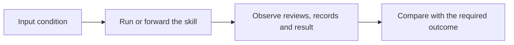

# Scenarios for assessing Sprint align

These cases say what the skill must do. They are not test results; record each actual trial with its client, date and evidence.

| Case | Input condition | Required outcome |
| --- | --- | --- |
| A1 Aligned feature | All stage evidence supports the change | Four independent reports, reconciled mappings, complete downstream preparation, `READY_FOR_09` |
| A2 Missing scenario | Purpose fits; an essential interaction is absent | `CHANGE_REQUIRED` naming the scenario and its owner; no readiness claim |
| A3 Weak evaluation | The only criterion is "works well" | Observable measures and a method are required before foundation alignment |
| A4 Cross-stage conflict | A use case needs explicit selection; architecture assumes automatic replacement | Both claims preserved; the behavioral decision is resolved, then the artifacts updated |
| A5 Changed direction | The human now asks for a feature an older page deferred | Current direction applied; stale pages and any sprint-record mismatch reconciled; the deferral is not a veto |
| A6 Stale evidence | A material source changes after the first reviews | Affected findings marked stale and rechecked before a current result |
| A7 POC required | A material feasibility question remains | Only a specified, authorized experiment after foundation alignment; findings integrated before `READY_FOR_09` |
| A8 POC unnecessary | Existing evidence settles the uncertainty | A recorded no-POC rationale; no invented experiment |
| A9 Technical maintenance | Work preserves an existing behavior or quality | Traced to the real obligation; all four assess impact; no invented feature |
| A10 Missing specialist | A requested review fails or never returns | Incomplete execution reported with its effect; no fabricated participation |
| A11 Active sprint | The sprint is already active | Identity, branch and scope preserved; no restart or manual state edit |
| A12 Orphan work or false completion | A plan adds unselected work, or validation is presented as approval | The readiness claim is rejected; scope rationale or current review evidence required; stop before coding |

## Routing cases

| Case | Input condition | Required outcome |
| --- | --- | --- |
| R1 Specialist invokes | A specialist chat is asked to align the sprint | It forwards to its verified coordinator, keeps its role and runs no team-wide review |
| R2 Unverifiable parent | The parent or channel cannot be verified | A concrete handoff text; execution reported as not occurred; no invented address or reply |
| R3 Run in progress | A second request arrives for the same sprint | It joins the existing run; no duplicate dispatch |
| R4 Admin chat | The coordinating chat is under ASDG Admin | The run does not start until the human returns it to Governance |

## What a trial must show

The skill and its adapters discovered in the named client; the real execution mode; separate first-pass reports; the reconciled coverage; a current plan and specification handoff; and `sprint status` identical before and after.
