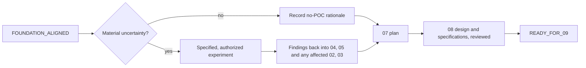

# From aligned foundations to implementation readiness

After stages 02 to 05 reconcile, three more stages make the work implementable. Two checkpoints keep the rule from being circular.

## Stage 06: decide whether a POC is needed

Architecture names feasibility risks, Evaluation defines the evidence needed, and the POC specialist frames the experiment. Record either a justified no-POC decision or the question the experiment must answer.
Any experiment needs foundation alignment plus its own plan and specification: hypothesis, permitted paths and data, method, observable thresholds, stop conditions, expected evidence and execution authority.
The existing active-sprint, per-target, role and runtime checks apply. Nothing is allowed because it is called a POC or lives under `poc/`, and an experiment never becomes an unreviewed feature.
Record measured outcomes and limits; running code is not proof of viability. Feed material findings back and revalidate alignment before continuing.

## Stages 07 and 08: make the work implementable

Planning completes the work breakdown, dependencies, sequence, owners and boundaries, linking every task to a selected commitment. Keep one authoritative task list; where the OpenSpec workflow owns implementation tasks, the plan links to them.
Low-Level Design specifies interfaces, data and state transitions, input and output contracts, failure handling, quality constraints and testable scenarios, preserving the upstream meaning.
ASDG-08 uses [the OpenSpec proposal wrapper](../asdg-openspec-propose/SKILL.md) and the installed native workflow where applicable, with its actual schema, paths and dependency order. Setup adds the native skills for a selected client when the `openspec` command is installed.
Complete the existing reviews of layout, behavior and specification, bundling related decisions. File existence, schema validation, a stage label or an agent's approving words are not human acceptance.

## Readiness rule

Return `READY_FOR_09` only when, for the whole bounded sprint:

- all four first-pass contributions are complete against compatible source versions and the relationships are reconciled;
- every material commitment has justified coverage, and no unresolved contradiction or missing decision prevents correct implementation or acceptance;
- Evaluation defines observable outcomes and how to assess them, and Architecture can support the behavior, constraints and observations;
- the POC decision is recorded and every required finding is incorporated;
- plan and specifications suffice for the scoped tasks, with traceability and current-state review evidence;
- the assessed inputs are current and no unselected work has entered the plan or specifications.

Otherwise return `NOT_READY` with the exact remaining work, or `NEEDS_DECISION` with one bounded human choice. Do not declare a subset ready and code around an unresolved commitment.
Readiness is an accountable assessment. It is not a second sprint state and adds no field to `.asdg/sprint.json`. ASDG-09 still verifies its role, sprint, path and execution conditions for each target.

## Freshness

A material change to the goal, scope, criteria, a cited source claim, the relevant architecture or a specification invalidates the conclusions that depend on it. Identify dependencies by exact path, section and hash or revision.
Recheck the affected stage and its downstream relationships; carry unchanged evidence forward with its provenance. A cosmetic edit needs an impact assessment, not a restart.
Ordinary implementation commits do not invalidate unchanged requirements and design; a discovered deviation or new material fact does. Recheck before stage 09 starts and whenever such a deviation arises.
