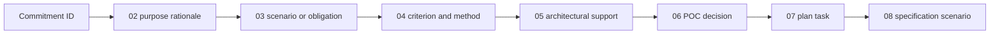

# The alignment and readiness report

One compact report, owned by Planning, records what was assessed and what it concluded. Product content stays in its stage-owned files, and OpenSpec artifacts stay where the native workflow puts them.

## Where it lives

Planning saves it in the project's planning folder under `docs/asdg/`, named by the conventions already in use there. It is ordinary owned documentation: no sprint is needed to write it, and it creates no new store.
Stage reports stay in their own stage folders; the report links to them and never copies them.

## What it records

| Part | Content |
| --- | --- |
| Identity | Project, sprint ID, the assessed sprint snapshot with its SHA-256, Git revision, observation time |
| Direction | Current explicit stakeholder instructions that bear on the sprint, quoted with their date |
| Sources | For each: path, hash, the relevant claim and its decision status |
| Reviews | For each reviewer: role, session or thread ID, execution mode, link to the saved report, verdict |
| Coverage | Per commitment ID: purpose, scenario or obligation, criterion, architectural support, POC decision, plan task, specification scenario |
| Conflicts | Each disagreement, the owner, the resolution or the open decision brief |
| Result | `FOUNDATION_ALIGNED` or not; then `READY_FOR_09`, `NOT_READY` or `NEEDS_DECISION`, with outstanding work and freshness dependencies |

If one coverage table grows too wide, give an upstream view (02 to 05) and a downstream view (06 to 08) keyed by the same commitment ID. Do not duplicate an authoritative fact to fill a cell; link it.

## Decision status of a source

Separate accepted current bytes, stale acceptance of older bytes, draft or unreviewed material, explicit stakeholder direction and unresolved questions, as [the evidence contract](../asdg-openspec-propose/evidence.md) defines.
An AI-MODIFIED receipt records authorship only. Never edit a review ledger by hand to make a source look accepted.
Separate intended behavior, actual observations and planned changes. Evaluation design is required before implementation; implementation results and live-user results are collected later.

## Limits

The report is evidence of an assessment at one time. It grants no approval, starts no work and changes no state.
It embeds a diagram of the relationships it found, as the [documentation standard](../../00-governance/docs/documentation-standard.md) requires, and stays within fifty nonblank lines per page; a larger sprint splits into linked pages.
