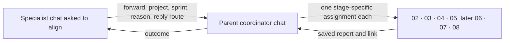

# Who runs an alignment, and how a request reaches them

One alignment run belongs to one coordinator. This page says where a request goes and how reviews are dispatched, without inventing a channel the client does not have.

## The coordinator owns the run

The owner is the existing coordinating parent session of the project's team, acting as 00 Governance. It dispatches the reviews, obtains the actual returns, reconciles cross-stage dependencies and presents unresolved decisions.
[Planning](../../07-planning/AGENTS.md), ASDG-07, assembles the common brief, owns the integrated plan and the [report](report.md), and prepares the implementation handoff. It does not approve its own plan.
A chat under ASDG Admin does not run an alignment: Admin does no project work. Return to Governance first, on the human's instruction.

## Requested inside a specialist

A specialist never runs the team-wide workflow and never assumes the parent role. It forwards the request and waits for the readiness result before dependent coding.
Resolve the parent from the verified team or session relationship, never from a title. If the immediate parent is another specialist, route upward to the owning coordinator.
Pass the project and sprint identity; the goal, scope and criteria or exact references; the reason for the request; and the originating session and reply route.
Forwarding an already authorized request needs no further permission from the human.
If the parent or the upward channel cannot be verified, give the human a concrete handoff text for the team chat and say that execution has not occurred. Never invent an address or report a parent's answer that was not received.

## Dispatching reviews

Send each stage owner one stage-specific assignment through the client's supported mechanism, to a chat verified for that project and role by its own receipt and stable ID.
Use parallel dispatch where the client supports and authorizes it; otherwise run the roles one after another, say so, and keep the first-pass reports separate.
Each assignment names the brief, the stage's question, the exact files that stage may change, and where to save its report. Assignments to different stages name disjoint files; overlapping edits are sequenced.
Record for every reviewer its role, session or thread ID, the time of the request and the evidence of its return. Read the saved report itself; a short completion note is not the review.

## Observed client mechanisms

In the Claude desktop app, a chat reads its own record and parent with the session tools, lists the team with the linked-session listing, and sends an assignment or a forward with the session message tool. Discover the current tool schemas; do not assume names.
In Codex, use the native parent and subagent channel or the project-chat tools described in [Create team](../asdg-create-team/create-chats.md).
Where a surface has neither, the coordinator performs each stage review itself only on the human's explicit instruction, discloses that the reviews were sequential and by one agent, and reports that independence between reviewers was not achieved.
