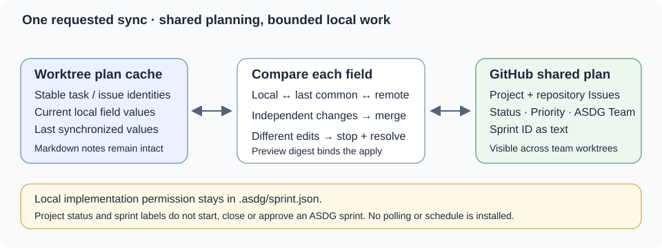

# Exercise the requested planning sync

[Source: test_plan_sync.py](test_plan_sync.py)

Maintainers use this suite to check a realistic on-demand sync across an isolated Git worktree and a fake GitHub service. No live account, credential, Issue or Project is accessed.

## Responsibilities and collaborators

- `FakeGitHub` implements the public [adapter contract](../scripts/lib/cli_plan_github.md), keeps observable remote records and injects failures before or after a mutation.
- `PlanSyncTests` creates disposable Git repositories, calls [the real orchestrator](../scripts/lib/cli_plan_sync.md), and checks files, Git identity, remote writes and recovery records.
- [Merge logic](../scripts/lib/cli_plan_merge.md) runs unchanged; tests assert resulting behavior rather than reproduce the merge algorithm.

| Scenario | Required outcome |
| --- | --- |
| Preview and first inventory | No file or remote mutation; imported identities visible before authoring new entries. |
| Create, import and independent edits | Required Project/fields/Issues exist once, local notes and documents survive, final bases match observed values, repeat sync converges. |
| Initially closed Issue | GitHub's OPEN create is followed by a single bounded state update. |
| Bootstrap from `dev` | Reads the structured cache without changing branch, HEAD or source documents; never resets an existing cache. |
| Stale preview or conflicting fields | Stops before mutations and exposes both values and their base. |
| Lost create response | Resume observes the existing result; an unknown outcome cannot trigger a blind retry. |
| Rejected write | Confirmed rejection clears pending ambiguity, permitting retry after permission repair. |
| Concurrent edits | Cache edits, branch changes and newly appearing unreviewed remote targets stop further affected writes. |
| Publication crash | Recovery reads back GitHub before completion; changed remote state preserves the published cache and reports reconciliation. |
| Abandonment | Exact original digest is required; local edits and partial remote results remain, evidence is archived, and unknown writes stay blocked by default. Explicit uncertainty acknowledgement archives evidence without replay. |
| Ownership and unsafe paths | The utility exception permits only its exact cache target for a known role; symlinks, hardlinks and repository mismatch fail closed. |

## Running and limits

Run `python3 -B -m unittest discover -s tests -p test_plan_sync.py -v` from the source repository.
The fixture uses real Git commands but simulates GitHub. It establishes portable orchestration and failure behavior, not live API compatibility, host skill discovery, credential permissions or human acceptance. The test author also wrote the skill guide; algorithm and orchestrator authors are separate, with shared implementation context.
