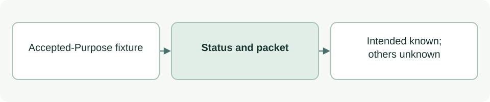

# Purpose-only project tests

[Source: test_purpose_only_status.py](test_purpose_only_status.py)

Checks a new project whose only substantive artifact is an accepted Purpose definition, with no implementation, operating evidence or Stage 07 plan.

## Responsibilities and collaborators

Shows that Purpose acceptance needs no evidence or plan, that initialization creates no retired perspective folders, and that a report section can state Actual and Planned as unknown.

- [continuation_fixture](continuation_fixture.md): Builds the disposable client with a simulated accepted Purpose.
- [purpose_review](../scripts/lib/purpose_review.md): Supplies the current criteria and Purpose paths.
- [report packets](../skills/asdg-report-project-status/report_packets.md): Validates the three-slide section.

## Interface and data

`PurposeOnlyProjectTests` builds one fixture per class and reads `asdg/scripts/cli.py status --json` from it.

| Test method | Responsibility |
| --- | --- |
| `test_purpose_is_accepted_on_its_own_criteria` | One registered definition reaches ACCEPTED under the seven current criteria. |
| `test_no_implementation_or_planning_record_exists` | Stages 03–12 hold no registered evidence; Stage 07 is MISSING and the sprint inactive. |
| `test_initialization_creates_no_retired_perspective_structure` | No `intended`, `current`, `planned` or plan-horizon folder exists; Purpose holds no capability or plan documents. |
| `test_report_section_derives_intended_and_leaves_other_views_unknown` | A section citing the accepted Purpose and reporting Actual and Planned unknown passes the packet checker. |

## Effects and failure behavior

The acceptance events are simulated. The report packet is authored by the test, so it shows that the checker accepts unknown views, not that a live worker derives them. Temporary files are removed after the class.

## Example

From the source root: `python3 -B -m unittest discover -s tests -p 'test_purpose_only_status.py'`.
