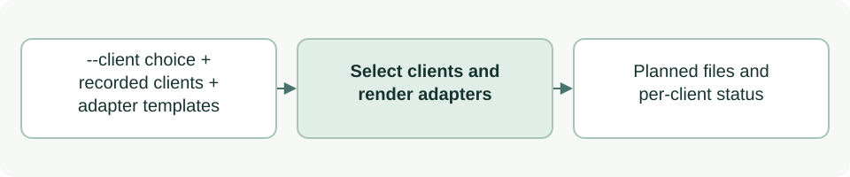

# Verify integration replacement boundaries

[Source: test_push_integrations.py](test_push_integrations.py)

Maintainers run these temporary-fixture tests before accepting changes to [integration replacement](../scripts/lib/cli_push_integrations.md). They exercise the public planner and ownership-aware status checks without touching real clients.

## Responsibilities and collaborators

The suite copies indexed template/mod members into one isolated source fixture and creates a fresh temporary client for every test. Existing [client rendering](../scripts/lib/cli_clients.md) supplies the equivalence oracle; [ownership validation](../scripts/lib/cli_push_inventory.md) checks emitted entry scope.

| Test group | Evidence |
| --- | --- |
| Claude, Codex and combined selection | Planning writes nothing; applying generated bytes makes repeat plans and verification no-ops. |
| Source and ownership | Generated adapters match existing renderers; unindexed skills are ignored; unknown collisions block; prior-owned edits and exact retired files reconcile. |
| Shared instruction blocks | Moved and legacy bootstraps retain exact user bytes; incomplete, inline or duplicate markers block; user Claude imports remain unclaimed. |
| Codex configuration | Unrelated values, comments and line endings survive; owned false values repair; unsupported parser and malformed or unowned conflicts fail closed. |
| Hook arrays | Unrelated entries and metadata survive; edited, missing and duplicate owned registrations block; changed or wrong-event legacy ASDG-like commands cannot gain duplicate behavior. |
| Unsafe files | Symlinks, hardlinks and duplicate JSON keys block without modifying targets. |
| Status | Valid bound ownership selects semantic verification; invalid identity and unfinished transactions fail closed before and after ownership publication; ordinary no-receipt initialization retains its existing exact checks. |

## Running and limits

Run `python3 -B -m unittest discover -s tests -p test_push_integrations.py -v` from the source repository.
Tests prove portable planning and checking, not Claude skill discovery, Codex hook execution or human trust. The transaction engine and source/receipt binding have separate tests.
