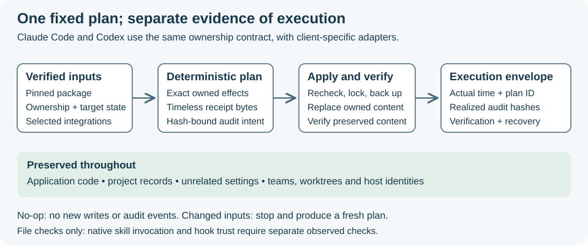

# Replacement acceptance tests

[Source: test_push_replace.py](test_push_replace.py) exercises the public command against initialized disposable Git repositories with realistic packaged sources.

`PushReplaceTests` creates isolated canonical/client fixtures. `initialize` uses the existing initializer, `run_replace` previews and applies one exact digest, and `snapshot` captures bytes and modes. The `git` and `seal` helpers establish fixture identity and integrity only.

Cases cover owned customizations, preserved unknown neighbors/application/state/history, verification and a no-write second run; clock-independent plans; source, target and ledger changes invalidating plans; unknown collisions; hostile ownership paths; and CLI preview/apply/verify.

Integration and transaction companions describe separate shared-file, fault, concurrency and recovery cases. These tests establish file behavior, not native skill discovery or hook trust.

Run `python3 -B -m unittest discover -s tests -p 'test_push*.py' -v` from the canonical source. Fixtures never use real clients or network services.
