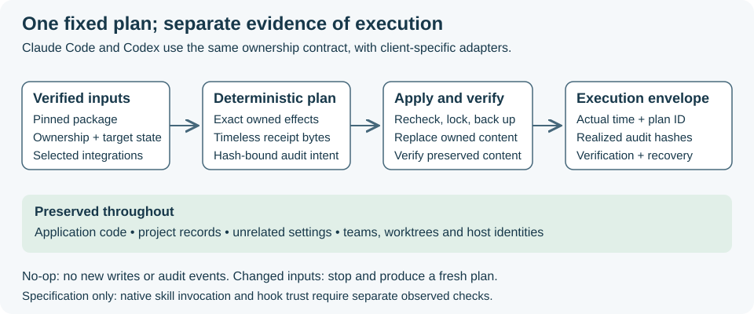

# Push-replace design contract checks

[Test source](test_push_replace_contract.py) checks the proposed source-only [catalog](../docs/asdg/07-planning/02.25-push-replace-catalog.json) and [ownership schema](../docs/asdg/07-planning/02.25-push-replace-ownership.schema.json). It performs no replacement and is not part of the client distribution.

| Collaborator | Responsibility |
| --- | --- |
| `receipt(client)` | Synthetic fixture with one exact Claude or Codex adapter; no client file writes. |
| `CatalogTests` | Check resolver completeness, unique IDs, symmetric obsolete cleanup and explicit preserved state. |
| `OwnershipSchemaTests` | Use Draft 2020-12 validation to accept both client fixtures and reject unsafe paths, missing original values, mismatched ownership, invalid hashes, timestamps and unknown fields. |
| `jsonschema` | Optional test-only validator. Missing dependency explicitly skips schema tests; it is not an ASDG runtime requirement. |

Run with an interpreter that has `jsonschema`: `python3 -B -m unittest discover -s tests -p test_push_replace_contract.py -v`. The test suite never installs dependencies itself.

Schema validation proves shape, not authenticity, permission, semantic catalog membership or safety of an apply engine. Semantic path/category binding and distinct entries colliding on one path/selector still require the future inventory validator. Clock-field rejection does not prove an unimplemented plan engine is deterministic.

No tests here claim native Claude Code or Codex invocation, hook trust, transaction recovery or Python versions that were not actually executed.
